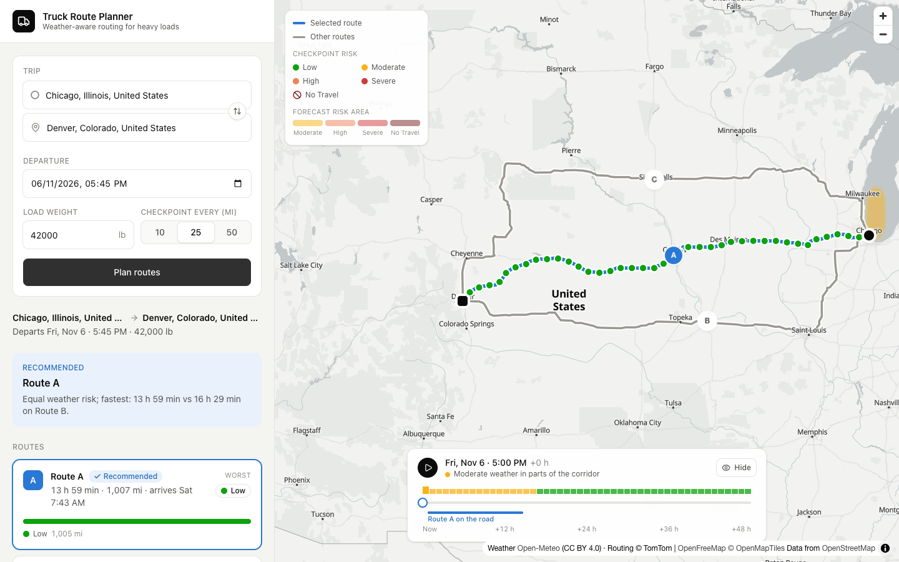
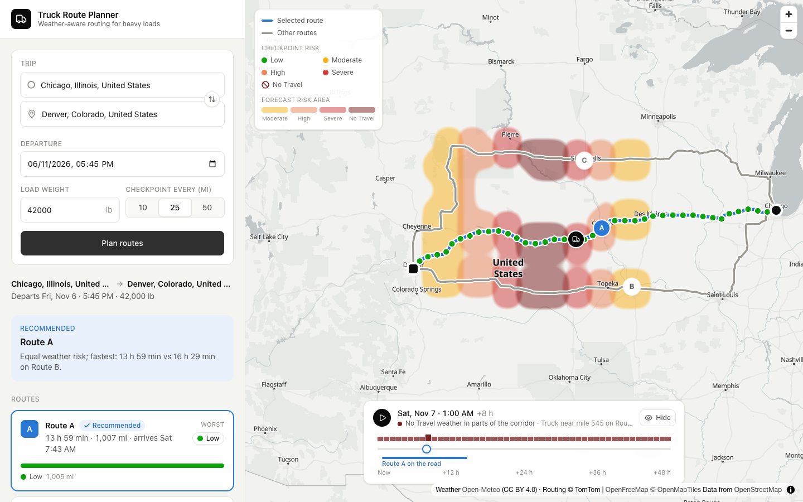

# Weather-Aware Truck Routing

A React + Django app that helps a truck driver choose the safest route. For three route options it checks the **forecast at the time the truck will actually reach each checkpoint**, applies **load-weight rules**, and recommends a route that balances weather risk against travel time. A 0–48 hour heatmap shows how the weather along the corridor changes.




<sub>Second image: the heatmap response was replaced with a simulated storm to show the slider, the risk timeline and the truck marker. Real forecasts render the same way.</sub>

## Quick start

Requires Docker with Compose v2.24+ and a free [TomTom API key](https://developer.tomtom.com) (no credit card).

```bash
cp .env.example .env      # set TOMTOM_API_KEY
docker compose up
```

Open **http://localhost:5173**. The frontend proxies `/api` to the Django backend (http://localhost:8000/api/health).

## What it does

1. **Three route options.** TomTom truck routing (gross weight = cargo + 35,000 lb tractor-trailer) with 2 alternatives. Near-duplicate routes are dropped and replaced by detours forced left and right of the midpoint. If TomTom is down, OSRM supplies car routes, clearly flagged.
2. **Checkpoints every 10, 25 or 50 miles**, plus the origin and destination. Each checkpoint's **ETA** is interpolated from the routing API's own per-maneuver travel times, so slow city stretches and fast highway stretches are reflected.
3. **Weather at each checkpoint's ETA hour** from Open-Meteo (wind, rain + showers, snowfall in mph and in/hr). NWS is the US fallback. Missing data is **Unknown**, never treated as Low.
4. **Risk per checkpoint** from the rules below, then **miles at each level per route**. Every mile is scored by its nearest checkpoint, so the weather at departure and arrival counts.
5. **Recommendation** by the brief's ranking, with the deciding reason stated, for example *"Fewest severe-or-worse miles: 0 mi vs 42 mi on Route A."*
6. **Map:** routes (A/B/C), checkpoints coloured by risk with detail popups, and a **0–48 h heatmap** over the corridor. Its slider includes an hour-by-hour risk timeline, the selected route's driving window, and a truck marker at the chosen time.
7. **Why it's risky:** switch the heatmap between Overall, Wind, Rain and Snow; the status line names the cause ("No Travel: rain up to 1.84 in/hr"); hover or tap any shaded spot for its wind (speed and direction), rain and snow and whether the load rule applied; and wind arrows show where the wind blows, sized by speed.

Search and planning work worldwide (tested with Chicago → Denver and Lahore → Karachi).

## Risk rules

Thresholds from the brief. Where the brief's ranges share an edge, the edge belongs to the **higher** level, except that No Travel starts strictly **above** 1.00 in/hr rain and 3.0 in/hr snow, as the brief states.

| Level | Wind (sustained, mph) | Rain (in/hr) | Snow (in/hr) |
|---|---|---|---|
| Low | < 25 | < 0.10 | < 0.5 |
| Moderate | 25 – < 35 | 0.10 – < 0.25 | 0.5 – < 1.0 |
| High | 35 – < 45 | 0.25 – < 0.50 | 1.0 – < 2.0 |
| Severe | 45 – < 55 | 0.50 – 1.00 | 2.0 – 3.0 |
| No Travel | ≥ 55 | > 1.00 | > 3.0 |

**Load rules** can only raise a level: 45–54 mph with a load over 30,000 lb is **No Travel**; 35–44 mph with a load over 40,000 lb is **Severe**. A checkpoint's level is the worst of wind, rain and snow, after the load rules.

**Ranking** (lowest wins): any No Travel miles → severe-or-worse miles → high miles → distance-weighted average risk → travel time. Values are compared at 0.1 mi / 0.001 so floating-point noise can't decide a winner.

The full rules live in [`backend/routing/domain/risk.py`](backend/routing/domain/risk.py) as data that reads like the table above. Every edge (24.9 / 25 mph, 0.10 in/hr, 1.00 vs 1.001, 30,000 vs 30,001 lb, …) is unit-tested.

## Architecture

```
React + MapLibre (Vite)  ──/api──▶  Django REST API ──▶ Redis cache
                                        │
          domain/   pure logic: risk rules, geometry, checkpoints + ETAs, ranking
          services/ routes (3 options + fallbacks), weather (0.1° cells), plan, heatmap
          providers/ TomTom · OSRM · Photon · Open-Meteo · NWS  (timeouts, retry, fallback)
```

| Need | Primary | Fallback |
|---|---|---|
| Truck routing | TomTom Routing | OSRM (car profile, flagged in the UI) |
| Place search | Photon (OpenStreetMap, worldwide) | TomTom Search |
| Weather | Open-Meteo | NWS (US only) |
| Map tiles | OpenFreeMap (Positron) | — |

Everything is free. Reliability details:
- **Every outside call has a timeout and one retry** on network errors, 429 and 5xx, and then falls back to the next provider.
- **Responses are cached in Redis:** place searches for 24 h, routes for 10 min, weather for 1 h, and plans for 1 h.
- **Weather is cached per 0.1° grid cell**, about 7 miles across. Every route, repeat plans and the heatmap share it.
- **API keys never appear in logs or error messages.**

| Endpoint | Purpose |
|---|---|
| `GET /api/geocode?q=&lat=&lon=` | Place search, ranked near an optional point |
| `POST /api/plan` | Routes, checkpoints, risk, recommendation, warnings |
| `GET /api/plan/{id}/heatmap` | ~300 corridor points × 49 hourly risk scores |

Full request and response shapes and error codes are in the [spec](docs/PROJECT_SPEC.md#9-api-contract).

**Performance**, measured on Chicago → Denver:

| | Empty cache | Cached | Size (gzipped) |
|---|---|---|---|
| Plan | ~7 s | ~0.7 s | 25 KB |
| Heatmap (with per-condition data) | ~1.4 s | ~35 ms | ~32 KB |

- **Why a plan takes ~7 s:** TomTom truck routing alone takes ~5 s on a long trip.
- **Slider:** 60 fps with no slow frames at normal drag speed, 58–59 fps on a fast drag. It never makes a network request.
- **Frontend bundle:** the main bundle is 94 KB gzipped. The map loads as a separate chunk.

## Hosting (free, auto-deploys on every push)

Everything is defined in [`render.yaml`](render.yaml), a Render Blueprint:

| Service | What it is | Free tier |
|---|---|---|
| `spotter-truck-routing` | The React build as a static site on Render's CDN. `/api/*` is proxied to the backend | Never sleeps |
| `spotter-truck-routing-api` | The Django API (`backend/Dockerfile` prod stage, gunicorn: 1 process × 8 threads) | Sleeps after 15 min idle and wakes in about a minute. The page pings `/api/health` on load so it's warming up while you fill in the form |

**One-time setup (about 5 minutes):**
1. Go to [dashboard.render.com](https://dashboard.render.com), sign in with GitHub, and click **New → Blueprint**.
2. Pick this repository. Render reads `render.yaml` and lists both services.
3. When asked for **`TOMTOM_API_KEY`**, paste your key, then click **Apply**.
4. When both services show **Live**, open the static site's URL (`https://spotter-truck-routing.onrender.com`).

From then on, every push to `main` redeploys whichever app changed. Backend changes rebuild only the API, and frontend changes only the site. GitHub Actions ([`ci.yml`](.github/workflows/ci.yml)) runs lint, type checks and all tests on every push.

**If something doesn't work:**
- **Render can't see the repo:** it belongs to the `CodilitySolutions` organisation, so an org admin may need to approve Render's GitHub app.
- **The API URL differs:** if the backend didn't get `https://spotter-truck-routing-api.onrender.com` (because the name was taken), copy its real URL into the `/api/*` rewrite in `render.yaml` and push.
- **The first plan is slow:** that's the free backend waking up. Open `/api/health` on the backend once before recording a demo.

No database is needed. Plans, routes and weather are cached in the API's memory for up to an hour, which is why it runs as a single process.

## Development

| Command | What it does |
|---|---|
| `make up` / `make down` | Start or stop the stack |
| `make test` | Backend (pytest, 193 tests) and frontend (Vitest, 29 tests) |
| `make lint` | Ruff, ESLint, `tsc` and Prettier checks |
| `make format` | Auto-format both apps |
| `make rebuild` | Rebuild after changing dependencies |

**How the tests run:**
- **Backend tests use recorded real API responses** ([`backend/tests/fixtures`](backend/tests/fixtures)), so they never call the live services. Re-record them with `docker compose run --rm backend python scripts/record_fixtures.py`.
- **Frontend tests** cover the heatmap, timeline and truck-position logic and the formatting helpers.

**Applying `.env` changes:** run `docker compose up -d`. Starting only the backend also stops the frontend, because the frontend depends on it.

**Adding dependencies:**
- **Backend:** `docker compose run --rm backend uv add <pkg>`, then `make rebuild`.
- **Frontend:** `docker compose run --rm frontend npm install <pkg>`, then `make rebuild`.

**Docker:**
- **Dev stack:** `compose.yaml` runs the dev stack with hot reload.
- **Production targets:** each Dockerfile also has a `prod` target. The backend's runs gunicorn; the frontend's runs nginx, serving the build and proxying `/api`.
- **Builds:** containers run as non-root users and install from lockfiles.

```
backend/   Django + DRF (config/, routing/{api,domain,providers,services}, tests/, scripts/)
frontend/  Vite + React + TypeScript + Tailwind + MapLibre (src/{api,components,lib})
docs/      Spec, tech stack, implementation plan, images
```

## Known limitations

- **Forecast window.** The trip must arrive within 48 h of now, the window the heatmap covers. Checkpoints on slower alternatives past that point are Unknown and left out of the score.
- **Weather resolution.** Weather comes from the nearest 0.1° cell (≤ ~4 mi away), at hourly steps. Open-Meteo hourly values are treated as in/hr.
- **Wind** is the sustained 10 m wind, as the rules specify. Gusts are shown but not scored.
- **Truck restrictions** (weight limits, banned roads) are only as detailed as TomTom's data for each country. OSRM fallback routes use a car profile, and the UI says so.
- **Heatmap scope.** The heatmap covers 40 miles either side of the routes, and fades out when zoomed in past regional scale, where the checkpoints are more precise. It has no NWS fallback, because NWS needs one request per point.
- **Rate limits.** Free tiers are ample for a demo: about 15 outside calls per uncached plan. Photon and OSRM are public community servers with fair-use limits.

## Data and attribution

- **Routing:** © TomTom.
- **Weather:** [Open-Meteo](https://open-meteo.com/) (CC BY 4.0) and the US National Weather Service.
- **Map:** [OpenFreeMap](https://openfreemap.org/) and © OpenMapTiles, with data © [OpenStreetMap](https://www.openstreetmap.org/copyright) contributors.
- **Place search:** [Photon](https://photon.komoot.io/), built on OpenStreetMap.

More detail: [Project spec](docs/PROJECT_SPEC.md) · [Tech stack](docs/TECH_STACK.md) · [Implementation plan](docs/IMPLEMENTATION_PLAN.md)
